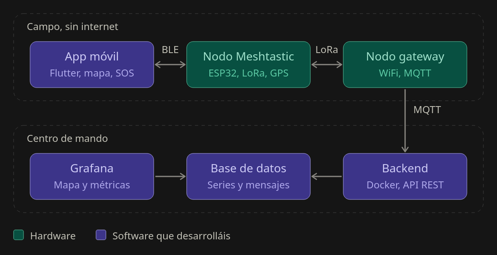

# ZeroInfra: comunicación de emergencia sin infraestructura

ZeroInfra permite que varias personas se comuniquen con el móvil en una zona donde no hay internet ni cobertura móvil, como tras una inundación, un terremoto o un apagón de la red. Cada móvil se conecta por Bluetooth a un pequeño nodo de radio LoRa. Los nodos forman entre sí una red mallada que retransmite los mensajes salto a salto y llega a kilómetros de distancia. Por esa red viajan mensajes de texto, la posición GPS de cada nodo y alertas SOS con prioridad. Cuando algún nodo tiene acceso a internet, hace de gateway y envía el estado de la red a un backend, donde un centro de mando lo ve en Grafana.

Proyecto de la asignatura PTI (FIB, UPC). Equipo: Cristina Frías, Shiqi Liang, Andrés Pociello y Carlos Sanz.

## 1. El problema

En una catástrofe, la infraestructura de comunicaciones es de lo primero que falla: se caen las antenas de telefonía, se corta la luz o la red se satura. En los episodios recientes de inundaciones, terremotos y conflictos armados, mucha gente ha quedado incomunicada justo cuando más necesitaba pedir ayuda o saber dónde estaban los suyos.

La pregunta de partida del proyecto fue: **¿qué pasaría si nuestros proveedores de internet desaparecieran?** Queríamos un canal alternativo que:

- no dependa de ninguna infraestructura previa (ni antenas, ni internet, ni electricidad de red);
- funcione con móviles normales y dispositivos baratos y de bajo consumo;
- cubra distancias de kilómetros, no los pocos metros de Bluetooth o WiFi directo;
- distinga una petición de auxilio de un mensaje cualquiera y la haga llegar antes.

## 2. Nuestra propuesta y objetivos

Construir una infraestructura completa de extremo a extremo, desde la radio hasta el centro de mando, sobre la red mallada abierta **Meshtastic** y la modulación de radio **LoRa**. Los objetivos del proyecto son:

1. Ofrecer un canal alternativo de comunicación de emergencia que funcione sin internet ni cobertura móvil.
2. Desplegar una red mallada Meshtastic sobre LoRa, con GPS, que alcance largas distancias mediante multi-salto.
3. Desarrollar una app móvil en Flutter (chat, mapa y SOS) que se conecte por Bluetooth Low Energy (BLE) al nodo.
4. Construir un backend (MQTT, base de datos y Grafana) para monitorizar el estado y la posición de los nodos.

## 3. Arquitectura



**Leyenda:** verde = hardware · morado = software que desarrolla el equipo.

El sistema tiene tres capas:

| Capa | Qué la forma | Qué hace |
|---|---|---|
| **Usuario** | App móvil Flutter | Chat de difusión y mensajes directos, mapa de nodos que funciona sin internet y botón SOS. Habla con su nodo por BLE. |
| **Red mallada** | Placas LilyGO T-Beam (ESP32 + radio LoRa + GPS) con firmware Meshtastic modificado | Retransmite los paquetes de nodo en nodo, cifrados, hasta su destino. Cada nodo informa de su posición y su batería. |
| **Centro de mando** | Nodo gateway, broker MQTT, base de datos, API REST y Grafana | El gateway publica por MQTT lo que oye en la malla; el backend lo guarda y lo muestra en un mapa y en métricas. |

### Cómo viaja un mensaje

1. La persona escribe en la app. La app lo empaqueta como un mensaje Protobuf de Meshtastic (`ToRadio`) y lo escribe en su nodo por BLE.
2. El nodo lo cifra con la clave del canal y lo emite por LoRa (868 MHz, banda libre en Europa).
3. Cada nodo que lo oye y no lo ha visto antes lo retransmite, restando un salto. El límite de saltos evita que circule para siempre, y la detección de duplicados evita retransmitirlo dos veces.
4. El nodo destino lo entrega a su móvil por BLE. Con los acuses de Meshtastic, el remitente ve si el mensaje ha salido de su nodo y si alguien lo ha recibido.
5. Si el gateway lo oye, lo publica por MQTT y el backend lo registra.

### Cómo viaja un SOS

El SOS no es un mensaje de texto. Es una alerta en **EMG1**, un formato binario propio, por un puerto reservado de Meshtastic (`PRIVATE_APP`, 256):

- Una cabecera de 20 bytes (tipo, gravedad, identificador, caducidad y nodo de origen) seguida de un texto con la posición: `@41.38879,2.11296 SOS`.
- El firmware modificado reconoce la alerta y la pone delante en la cola de envío, **en el nodo que la emite y en cada nodo que la retransmite**.
- Para no dar prioridad a alertas falsas, un retransmisor solo la eleva si Meshtastic ha verificado la firma digital (XEdDSA) del emisor. La app marca como «no verificada» la alerta que no la trae.
- La alerta se identifica por (nodo de origen, id), de modo que se descarta si llega repetida por varios caminos. Se cancela con otro mensaje EMG1 (`RESOLVED`) con el mismo id.

## 4. Componentes

### 4.1 Nodos y firmware (`hardware/`)

Cada nodo es una **LilyGO T-Beam**: microcontrolador ESP32, radio LoRa y GPS, alimentada por batería. Llevan **Meshtastic 2.8.2** con modificaciones propias (submódulo `hardware/firmware-emergency`), que se aplican como parches incrementales y verificables:

| Parche | Qué añade |
|---|---|
| Módulo de emergencias ([`patchkit-01.md`](hardware/patchkit-01.md)) | Formato EMG1, caducidad, descarte de duplicados, recibos de aplicación, almacén en RAM de las 8 últimas alertas y recuperación bajo petición (`FETCH`/`REPLAY`). Métricas de la cola de transmisión y de recepción. Una política opcional de *aging* que sube poco a poco la prioridad de los mensajes que llevan tiempo esperando, sin pasar nunca por delante de una alerta. |
| Prioridad en cada salto ([`patchkit-02.md`](hardware/patchkit-02.md)) | Cada retransmisor da prioridad ALERT a una alerta EMG1 válida y con firma verificada, sin cambiar el formato de la trama LoRa. |
| SOS abierto ([`patchkit-03.md`](hardware/meshtastic_emergency_open_sos_patchkit/patchkit-03.md)) | Cualquier nodo puede pedir ayuda (antes había una lista de nodos autorizados); la prioridad en los retransmisores sigue exigiendo la firma. |

Cada parche incluye un aplicador que comprueba los puntos de inserción antes de escribir, tests que se ejecutan en el ordenador sin placa y una herramienta de línea de comandos para generar, enviar y escuchar alertas EMG1 ([`testing-emg1-python-cli.md`](hardware/testing-emg1-python-cli.md)).

### 4.2 App móvil (`app/`)

App en **Flutter** (Android, y iOS sin probar todavía) con cuatro pestañas:

- **Nodos:** busca las placas cercanas por BLE, se empareja con PIN y muestra el estado de la conexión y los nodos de la malla.
- **Chat:** difusión por canal y mensajes directos, con el estado de entrega de cada mensaje (en cola, aceptado por el nodo, confirmado o fallido) y el límite de 233 bytes de Meshtastic.
- **Mapa:** posición de cada nodo, sobre cartografía de OpenStreetMap descargada antes de salir (detalle local de 1,5 km y contexto regional de 20 km) para usarla sin conexión.
- **SOS:** envía y cancela la alerta del propio nodo y muestra las alertas activas de los demás.

La app **no usa la app oficial de Meshtastic**: implementa directamente su Client API sobre BLE. Está organizada en capas para que la interfaz no dependa del hardware:

```text
vistas ─→ providers ─→ MeshRepository ─┬─ MeshtasticClient ─→ BleMeshTransport ─→ MeshtasticBleService
                                       │   (protocolo Protobuf)  (permisos)          (Bluetooth, flutter_blue_plus)
                                       └─ FakeMeshRepository (malla simulada, sin placa)
```

- **`MeshtasticBleService`:** escaneo, conexión, emparejamiento y lectura y escritura de las características BLE de Meshtastic.
- **`MeshtasticClient`:** el protocolo. Pide la configuración del nodo al conectar, mantiene nodos y canales, envía mensajes con identificador propio para casarlos con su acuse, y codifica y decodifica el SOS en EMG1.
- **`MeshRepository`:** el contrato del que dependen las vistas. Tiene una segunda implementación, `FakeMeshRepository`, que simula una malla completa (nodos, mensajes y alertas), para desarrollar la interfaz sin placas.
- **Providers** (`provider`): el estado de cada pestaña.
- **Código Protobuf:** generado a partir de los `.proto` oficiales de Meshtastic, que se guardan una sola vez en `protos/`.

La app tiene **25 tests automáticos** que se ejecutan sin Bluetooth ni placa. Los de la capa de datos usan un nodo simulado a nivel de bytes y cubren la conexión, los mensajes, los acuses, los errores y el SOS. Los del códec EMG1 usan los mismos vectores binarios que la herramienta de pruebas del firmware.

### 4.3 Backend (`backend/`)

Recibe por MQTT lo que publica el gateway, lo guarda y lo muestra:

- **Mosquitto:** el broker MQTT.
- **Base de datos:** guarda el historial de posiciones y el estado de los nodos.
- **API REST:** por ejemplo, `/health` y `/location`.
- **Grafana:** mapa de nodos y métricas.

Se despliega en contenedores sobre un clúster Kubernetes (k3s) en máquinas de la FIB; está en desarrollo ([`docs/BACKEND.md`](docs/BACKEND.md)).

## 5. Decisiones técnicas

| Decisión | Por qué |
|---|---|
| **LoRa** como radio | Alcance de kilómetros con muy poco consumo y en banda libre (868 MHz). A cambio, transmite poco: un paquete de Meshtastic lleva como máximo 233 bytes de datos. |
| **Meshtastic** como red mallada | Firmware abierto y maduro que ya resuelve el enrutamiento multi-salto, el cifrado por canal, los acuses y la posición GPS. Nos permite centrarnos en lo que falta para un uso de emergencia. |
| **App propia sobre la Client API** | La app oficial de Meshtastic no conoce nuestras alertas EMG1 ni su verificación. Hablar directamente el protocolo (BLE + Protobuf) nos da control sobre el SOS y la interfaz. |
| **EMG1 dentro de `PRIVATE_APP`** | Las alertas viajan como datos de aplicación sin tocar el formato de la trama LoRa. La red sigue siendo compatible con nodos Meshtastic estándar, que las retransmiten aunque no las entiendan. |
| **Prioridad solo con firma verificada** | Si cualquiera pudiera marcar un paquete como alerta, podría colarse en todas las colas. Exigir la firma XEdDSA que ya verifica Meshtastic limita ese abuso sin criptografía propia. |
| **Flutter** | Un solo código para Android e iOS. |
| **Capa de datos con contrato e implementación simulada** | El equipo puede desarrollar la interfaz y probar la lógica sin depender de que haya placas disponibles. |
| **MQTT** entre gateway y backend | Publicación/suscripción ligera, pensada para dispositivos limitados y redes poco fiables, y soportada de serie por Meshtastic. |
| **Monorepo** con una sola copia de los `.proto` | La app y el backend usan exactamente la misma definición de los mensajes, fijada a la versión del firmware de las placas. |

## 6. Qué aporta el proyecto

- **Prioridad de emergencia en toda la ruta.** Meshtastic de serie solo prioriza en el nodo emisor. Nuestro firmware la mantiene en cada salto, de forma verificable y sin romper la compatibilidad.
- **Un protocolo de alertas propio (EMG1)**, con identificador, gravedad, caducidad, cancelación, recibos y recuperación de alertas perdidas. Está implementado en el firmware (C++), en la app (Dart) y en la herramienta de pruebas (Python), y las implementaciones se contrastan con los mismos vectores binarios.
- **Una política de colas** (*aging*) para que los mensajes normales no esperen para siempre detrás de las alertas. Es una de las extensiones planteadas en la propuesta.
- **Integración de extremo a extremo** de piezas de naturaleza muy distinta: radio, firmware embebido, Bluetooth, app móvil, MQTT y backend en Kubernetes.

## 7. Estructura del repositorio

```text
ZeroInfra/
├── app/        # App móvil Flutter
├── backend/    # Infraestructura del backend: Terraform, Kubernetes, Mosquitto, base de datos, API REST y Grafana
├── hardware/   # Firmware modificado (submódulo), parches, herramientas de prueba y manuales de flasheo
├── protos/     # Definiciones Protobuf de Meshtastic
├── tool/       # Scripts de apoyo (generación de código a partir de los .proto)
├── docs/       # Documentación técnica
└── README.md
```

| Directorio | Contenido | Responsable |
|---|---|---|
| `app/` | App móvil: interfaz (chat, mapa, SOS) y capa de datos (BLE, protocolo Meshtastic, providers). | Carlos (interfaz) y Shiqi (conexión BLE, protocolo y capa de datos) |
| `backend/` | Servicios que reciben los datos del gateway por MQTT, los almacenan y los muestran en Grafana. | Andrés |
| `hardware/` | Firmware de las placas T-Beam y del gateway, parches de emergencia, pruebas y manuales. | Cristina |
| `protos/` | Copia única de los `.proto` de Meshtastic, que usan la app y el backend. | Shiqi y Andrés, con la versión de firmware que indica Cristina |
| `tool/` | Scripts que regeneran el código a partir de los `.proto`. | Shiqi y Andrés |
| `docs/` | Documentación técnica de cada parte. | Cada documento, quien trabaja esa parte |

## 8. Cómo probarlo

| Para... | Ver |
|---|---|
| Preparar el entorno y ejecutar la app | [`app/README.md`](app/README.md) |
| Probar la app sin placas, con la malla simulada | `cd app && flutter run --dart-define=FAKE_MESH=true` |
| Ejecutar los tests de la app | `cd app && flutter test` |
| Flashear una placa con Meshtastic | [`hardware/flashing-esp32.md`](hardware/flashing-esp32.md) (en catalán) |
| Aplicar los parches de emergencia al firmware | [`hardware/patchkit-01.md`](hardware/patchkit-01.md), [`patchkit-02.md`](hardware/patchkit-02.md) y [`patchkit-03.md`](hardware/meshtastic_emergency_open_sos_patchkit/patchkit-03.md) |
| Enviar y escuchar alertas EMG1 desde el ordenador | [`hardware/testing-emg1-python-cli.md`](hardware/testing-emg1-python-cli.md) |

## 9. Documentación técnica

| Documento | Contenido |
|---|---|
| [`docs/BLE_MESHTASTIC.md`](docs/BLE_MESHTASTIC.md) | Cómo habla la app con el nodo: servicio y características BLE, conexión, emparejamiento, envío, acuses y puertos. |
| [`docs/PROTOBUF.md`](docs/PROTOBUF.md) | Origen y versión de los `.proto` y cómo regenerar el código. |
| [`docs/APP_CAPA_DATOS.md`](docs/APP_CAPA_DATOS.md) | Guía de la capa de datos de la app: providers, modelos, chat y SOS. |
| [`docs/CAMBIOS_CAPA_DATOS.md`](docs/CAMBIOS_CAPA_DATOS.md) | Diseño de la capa de datos pieza a pieza y el porqué de cada decisión. |
| [`docs/BACKEND.md`](docs/BACKEND.md) | Infraestructura del backend. |
| `hardware/` | Parches del firmware, cambios por fichero y pruebas. |

## 10. Limitaciones conocidas

- **Firmware experimental:** los parches no están certificados para emergencias reales y no garantizan latencia, cobertura ni entrega.
- **Autenticidad de las alertas:** depende de la firma de Meshtastic. Una alerta sin firma verificada puede ser una suplantación; la app la muestra como «no verificada». Meshtastic solo firma las difusiones, así que un SOS dirigido a un nodo concreto no tiene prioridad en los retransmisores.
- **Alcance real por medir:** faltan las pruebas de campo de alcance y de tasa de entrega con varias placas.
- **App:**
    - sin reconexión automática por Bluetooth;
    - el historial de mensajes vive en memoria;
    - si se cierra con un SOS activo, ya no puede cancelarlo;
    - iOS sin probar.
- **Precisión de la posición:** depende de la configuración de cada canal de Meshtastic, que por defecto la reduce a propósito.
- **Backend:** en desarrollo.

Las limitaciones de cada parte se detallan en su documentación.
