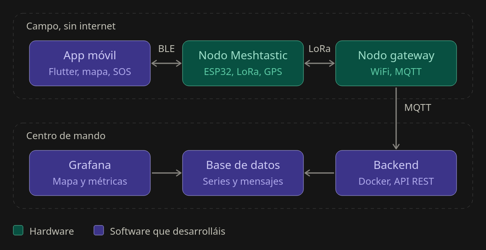

# ZeroInfra

Infraestructura de comunicación de emergencia para zonas sin cobertura (catástrofes): varios móviles se comunican entre sí a través de una red mallada Meshtastic sobre LoRa, sin internet ni cobertura móvil. Un nodo gateway reenvía el estado de la malla por MQTT a un backend en la nube, donde se monitoriza con Grafana.

Proyecto de la asignatura PTI.

## Arquitectura en breve



**Leyenda:** verde = hardware · morado = software que desarrolla el equipo

- **Frontend:** app móvil con chat, mapa y botón SOS, conectada por BLE a un nodo Meshtastic.
- **Red mallada:** nodos ESP32 con radio LoRa y GPS que retransmiten mensajes por multi-salto.
- **Backend:** servicios en contenedores que reciben los datos del gateway por MQTT, los guardan y los muestran.

## Estructura del repositorio

```
ZeroInfra/
├── app/        # Proyecto Flutter (la app móvil)
├── backend/    # Docker Compose: Mosquitto, base de datos, API REST y Grafana
├── hardware/   # Placas, gateway y manuales de flasheo
├── protos/     # Definiciones Protobuf de Meshtastic
├── tool/       # Scripts de apoyo (generación de código desde los .proto)
├── docs/       # Documentación del proyecto
└── README.md
```

## Directorios: objetivo y responsables

| Directorio | Objetivo | Quién lo modifica |
|---|---|---|
| `app/` | Contiene la aplicación móvil Flutter con chat, mapa y SOS, que se conecta por BLE al nodo Meshtastic. | Carlos (interfaz) y Shiqi (conexión BLE y protocolo). El reparto interno está más abajo. |
| `backend/` | Contiene los servicios en la nube que reciben los mensajes MQTT del gateway, los almacenan y los muestran en Grafana. | Andrés |
| `hardware/` | Documenta y guarda la configuración de las placas T-Beam y del nodo gateway: flasheo, pruebas de alcance y puente MQTT. | Cristina |
| `protos/` | Guarda una única copia de los `.proto` de Meshtastic, fijada a la versión del firmware de las placas, que usan la app y el backend. | Shiqi y Andrés. Cristina informa de la versión exacta del firmware. |
| `tool/` | Reúne los scripts que regeneran el código Dart (y el del backend) a partir de los `.proto`. | Shiqi, y Andrés para el script del backend |
| `docs/` | Recoge la documentación del proyecto: arquitectura, protocolo BLE, protobufs, estados de nodo, pruebas y decisiones. | Todo el equipo; cada documento lo mantiene quien trabaja esa parte |

### Reparto dentro de `app/`

| Ruta (dentro de `app/`) | Quién |
|---|---|
| `lib/views/` (chat, mapa, SOS) | Carlos |
| `lib/views/nodes/` (escaneo y conexión BLE) | Shiqi |
| `lib/core/`, `lib/data/`, `lib/providers/`, `lib/generated/` | Shiqi |
| `lib/models/` | Carlos y Shiqi, de común acuerdo |
| `lib/main.dart` | Carlos; Shiqi solo para registrar los providers |
| `android/`, `ios/`, `pubspec.yaml` | Quien necesite el cambio, avisando al resto |
